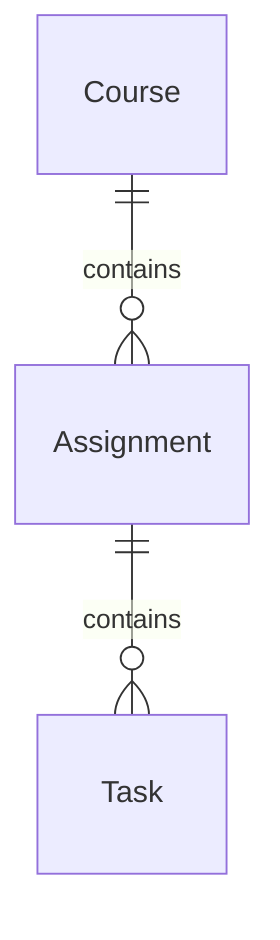

# StudyFlow specification

Status: first six vertical slices complete, 2026-10-07, including live MCP success/invalid-input/missing-repository evidence. Step 7's final demonstration and review remains planned. Domain vocabulary is in [GLOSSARY.md](GLOSSARY.md).

Implemented now: course and assignment CRUD, checklist task create/list/rename/complete/reopen/delete API and browser flows, optional calendar dates, derived progress, offline repository-reference management, explicit summary loading/refresh through real stdio MCP, recoverable integration errors, cascade deletion, SQLite persistence, packaging, and verification hooks. The routine suite has 216 tests and the browser suite has 53 tests. Actual TDD and verification results are in [first-slice evidence](docs/evidence/first-slice.md), [course-management evidence](docs/evidence/second-slice.md), [assignment evidence](docs/evidence/third-slice.md), [checklist evidence](docs/evidence/fourth-slice.md), [repository-reference evidence](docs/evidence/fifth-slice.md), [MCP-slice evidence](docs/evidence/sixth-slice.md), [MCP runtime evidence](docs/evidence/mcp.md), [fast-hook evidence](docs/evidence/hook.md), and [final-hook evidence](docs/evidence/final-hook.md). Reference CRUD makes no GitHub calls. Live MCP calls succeeded after supplying an optional token; earlier rate-limit outcomes are preserved as historical evidence.

## Goal and scope

Help one student manage university courses, assignments, and assignment checklists, with useful GitHub repository metadata beside coursework. Build a local educational CRUD application and demonstrate a working agent development environment.

MVP:

- Create, list, view, edit, and delete courses and assignments.
- Create, edit, complete/reopen, and delete assignment tasks; show derived progress in assignment lists and details.
- Attach, replace, or remove one optional public GitHub repository reference per assignment; explicitly load or refresh its summary.
- Deliver three browser views: course list, course detail with assignments, and assignment detail with checklist and repository panel.
- Demonstrate the existing skills, repository instructions, automatic verification feedback, and successful and erroneous custom MCP calls; record evidence and reflection.

Non-goals: accounts/authentication, multiple students, collaboration, grades/submissions, notifications, calendar synchronization, task priorities/dependencies/reordering, multiple repositories per assignment, private repositories/OAuth, GitHub writes or issue synchronization, background refresh, offline GitHub snapshots, deployment infrastructure, or an AI feature inside the product. The app binds to loopback for local use; public hosting requires a separate scope decision.

## Main scenarios

1. Create a course, open it, and add an assignment with a title, description, and optional due date.
2. Add three tasks and complete one: the assignment shows `1 / 3` and `33%`. Complete/reopen tasks and see the updated progress after each saved change.
3. Edit coursework details, remove an obsolete task, or delete an assignment/course. The browser confirms destructive actions and explicitly describes cascading deletion.
4. Attach `owner` and `repo` to an assignment, then select “Load repository summary.” See the repository link, description, default branch, up to three languages, last push time, and fetch time.
5. A repository is missing or GitHub is unavailable: the repository panel shows a recoverable error; coursework and the saved reference remain usable.

## Domain model

One coursework context; no separate bounded contexts or aggregate framework.

| Concept | Kind and owned data | Relationships |
| --- | --- | --- |
| Course | Entity: ID, name, description | Has zero or more assignments |
| Assignment | Entity: ID, course ID, title, description, optional due date, optional repository reference | Belongs to exactly one course; has zero or more tasks |
| Task | Entity: ID, assignment ID, title, completion flag | Belongs to exactly one assignment |
| Repository reference | Value object: GitHub owner and repository name | Embedded in assignment; no independent CRUD/lifecycle |
| Due date | Optional calendar-date value | Belongs to assignment, without time or timezone |
| Assignment progress | Derived value: completed task count, total task count, integer percentage | Calculated from current tasks, never set by the user |
| Repository summary | External read result | Describes GitHub, not coursework state |



Value objects mean validated values; they do not require a hierarchy of wrapper classes. A checklist is an assignment's task collection, not a fourth entity. The student is the actor, not a persisted User entity in this MVP.

### Invariants and edge cases

- Names/titles are trimmed, nonblank, and at most 200 characters. Descriptions are plain text, default to `""`, and are at most 5,000 characters. Duplicate names and titles are allowed; identity comes from IDs.
- IDs are generated positive integers and immutable. Assignment/course and task/assignment links are mandatory and immutable; moving items is outside the MVP. Parents must exist before children can be created.
- Task completion is a strict boolean, initially `false`. Completing twice is harmless; reopening is permitted. There is no independent assignment status or completion switch.
- Progress is `0` for no tasks; otherwise `floor(100 * completed / total)`. Always display counts alongside percentage. A checklist is complete only when `total > 0` and `completed == total`.
- Adding an incomplete task can reduce progress. Deleting a task recomputes progress; deleting the last task gives `0 / 0`, `0%`, and “No tasks.” An assignment without a checklist cannot be marked complete in the MVP. Checklist completion does not imply submission or a passing grade.
- Due dates must be real dates in `YYYY-MM-DD` form; past dates are allowed. They describe coursework, without scheduling or overdue automation.
- A repository reference is either absent or a complete validated pair. The same pair may appear on multiple assignments. Store owner/repo lowercase for case-insensitive comparison; do not silently strip `.git` or parse arbitrary clone URLs.
- Saving a syntactically valid reference does not require a GitHub lookup. Removing/replacing it discards any currently displayed summary. Repository renames do not automatically rewrite coursework; the student can update the reference.
- Deleting a course atomically deletes its assignments and their tasks; deleting an assignment deletes its tasks. Deleting coursework never deletes anything on GitHub. No soft deletion or undo.

### Decisions and alternatives

| Decision | Alternatives and tradeoff | Chosen rule |
| --- | --- | --- |
| Ownership | A shared/team system needs users and access control; a local student workspace needs neither | One local workspace, no user table |
| Repositories | Many support split projects but add link management; one covers a normal coursework repository | Zero or one per assignment; sharing a reference across assignments is allowed |
| Progress | Manual assignment status supports taskless completion but can disagree with the checklist; weighted tasks need effort estimates | Equal-weight task completion only, including explicit empty-checklist behavior |
| Deletion | Restricting parents adds cleanup work; soft deletion adds lifecycle rules; cascading is simple but irreversible | Cascade with browser confirmation |
| GitHub state | Persisted snapshots work offline but need freshness rules and invalidation | Persist only the reference; fetch metadata explicitly |
| Reference validation | Checking existence when saving gives immediate feedback but makes local CRUD depend on GitHub | Validate syntax on save; validate availability on summary request |
| Architecture | React plus a separate backend adds a build/runtime; Django brings facilities this MVP does not need | FastAPI, templates, small JavaScript, SQLite |
| Integration boundary | Direct GitHub access plus an agent-only MCP is simpler at runtime but duplicates entry points and weakens the requested boundary | Both the app and agent use the custom MCP tool; [ADR 0001](docs/adr/0001-github-through-mcp.md) records this deliberate cost |

## Persistence

Use Python's `sqlite3` with parameterized SQL. Database path defaults to `data/studyflow.sqlite3`, configurable through `STUDYFLOW_DB_PATH`. Ignore local databases and verification artifacts in Git.

| Table | Columns |
| --- | --- |
| `courses` | `id INTEGER PRIMARY KEY`, `name TEXT NOT NULL`, `description TEXT NOT NULL DEFAULT ''` |
| `assignments` | `id INTEGER PRIMARY KEY`, `course_id INTEGER NOT NULL`, `title TEXT NOT NULL`, `description TEXT NOT NULL DEFAULT ''`, `due_date TEXT NULL`, `github_owner TEXT NULL`, `github_repo TEXT NULL` |
| `tasks` | `id INTEGER PRIMARY KEY`, `assignment_id INTEGER NOT NULL`, `title TEXT NOT NULL`, `is_completed INTEGER NOT NULL DEFAULT 0` |

Enable foreign keys on every connection; both parent foreign keys use `ON DELETE CASCADE`. Index `assignments(course_id)` and `tasks(assignment_id)`. Add CHECK constraints for title/name lengths, description lengths, completion in `{0,1}`, and both repository columns being null or both nonnull. Calendar validity and repository syntax are validated before persistence.

Open/close connections per operation, use one transaction per mutation, and roll back failures. Reads assembling an assignment and its progress use a consistent read transaction. Keep database transactions out of GitHub calls. Last committed edit wins in this single-user MVP; no optimistic-lock version field.

Use numbered SQL migrations in `studyflow/migrations/` and SQLite `user_version`, applied in order by `python -m studyflow.db migrate` and on application startup. Keeping migrations inside the package makes them available in installed wheels; startup applies pending forward migrations without resetting data. No migration framework or destructive automatic reset. Add only tables/columns needed by the current vertical slice. Never store progress, GitHub descriptions/languages/activity, tokens, or fetched summaries.

Current migrations implement the table outline above through version 4. Migration `003_tasks.sql` adds the task table and its `assignment_id` index; `004_repository_references.sql` adds nullable `github_owner` and `github_repo` columns with a complete-pair CHECK. Existing assignments receive absent references, and existing coursework, progress, and foreign-key cascades are preserved. No repository summary data is stored.

## Architecture and stack

Python 3.12, FastAPI/Pydantic, Uvicorn, Jinja2 templates, plain CSS and small JavaScript modules, SQLite, HTTPX, and the official Python MCP SDK. Use pytest with FastAPI TestClient, plus a small pytest/Playwright browser suite. FastAPI documents both [template rendering](https://fastapi.tiangolo.com/advanced/templates/) and [pytest-compatible HTTP testing](https://fastapi.tiangolo.com/tutorial/testing/).

One Python project and virtual environment, with pinned dependencies in `uv.lock` and `pyproject.toml`. No frontend package manager or asset compilation. The MCP server is a local stdio subprocess, not a separately deployed service.

```text
Browser -> web/API -> coursework functions -> SQLite
                         |
                         +-> MCP client -> local MCP server -> GitHub REST API
Agent -------------------------------> local MCP server -> GitHub REST API
```

Implemented structure:

| Location | Concrete responsibility |
| --- | --- |
| `studyflow/web.py` | App factory, HTML/JSON routes, transport validation and error mapping |
| `studyflow/domain.py` | Coursework value validation and progress calculation; no HTTP, SQL, or MCP imports |
| `studyflow/coursework.py` | Use-case functions, parent checks, transaction coordination; shared by HTML reads and JSON API |
| `studyflow/db.py`, `studyflow/migrations/` | SQLite connections, packaged migrations, concrete SQL operations; no generic repository abstraction |
| `studyflow/github_mcp_client.py` | Call exactly one tool, validate results, translate integration errors |
| `studyflow/templates/`, `studyflow/static/` | Three pages, accessible forms, checklist controls, repository panel |
| `studyflow_mcp/server.py`, `studyflow_mcp/github.py` | Tool contract/stdio entry point and the only production GitHub HTTP access |
| `studyflow_mcp/models.py` | Closed input/output schemas and result validation |
| `tests/` | HTTP, MCP, verification-hook, and browser behavior tests |
| `scripts/verify_after_change.py`, `.codex/hooks.json` | Automatic local test feedback |
| `docs/evidence/`, `reflection.md` | Actual demonstration records and retrospective, added during implementation |

Use ordinary functions and explicit parameters for the database location and integration callable; no dependency-injection container, abstract service hierarchy, event bus, CQRS, generic CRUD engine, or separate domain persistence models. Pydantic handles public schemas; small pure functions enforce rules shared by entry points.

Templates render server-side data. JavaScript sends same-origin JSON mutations, shows validation errors, and reloads the page after successful changes. The repository panel fetches separately and does not delay the page. Preserve form input on failure, disable repeated in-flight submissions, and provide labelled fields, keyboard-operable checkboxes, and explicit empty/loading/error states. Render all student and GitHub text escaped. Accept JSON for mutations; do not enable cross-origin access or accept form-encoded writes.

### Local commands to establish during implementation

Run from the StudyFlow directory, which currently sits inside a larger Git repository:

```sh
uv sync --frozen
uv run python -m studyflow.db migrate
uv run uvicorn studyflow.web:create_app --factory --host 127.0.0.1 --port 8000
uv run pytest -q
uv run playwright install chromium
uv run pytest -q -m browser
uv build
uv run python -m studyflow_mcp.server
```

Dependencies are resolved in the committed `uv.lock`, targeting Python 3.12. Default pytest selection excludes `browser` and opt-in `live` network tests. `uv build` packages `studyflow`, `studyflow_mcp`, templates/static assets, and migrations. An isolated installed-wheel smoke check passed, including actual packaged MCP discovery and invalid-input handling. In this workspace uv is available at `.tools/bin/uv`; [README.md](README.md) records the local-tooling environment variables. Browser verification used installed Chrome with `--browser-channel chrome`.

## API and use cases

All JSON routes use `/api`. Lists return arrays, ordered by ID ascending, with no pagination in this small local dataset. Create returns `201` and the created resource; reads and patches return `200`; successful deletes return `204`. Missing IDs return `404`, including repeated deletion.

| Routes | Input/behavior |
| --- | --- |
| `GET /courses`, `POST /courses` | List courses; create with required `name`, optional `description` |
| `GET /courses/{id}`, `PATCH /courses/{id}`, `DELETE /courses/{id}` | Read; edit `name`/`description`; cascade delete |
| `GET /courses/{id}/assignments`, `POST /courses/{id}/assignments` | List with progress; create with required `title`, optional `description`, `due_date`, `repository` |
| `GET /assignments/{id}`, `PATCH /assignments/{id}`, `DELETE /assignments/{id}` | Read with progress; edit `title`/`description`/`due_date`/`repository`; cascade delete |
| `GET /assignments/{id}/tasks`, `POST /assignments/{id}/tasks` | List tasks; create with required `title`, initially incomplete |
| `PATCH /tasks/{id}`, `DELETE /tasks/{id}` | Edit `title` and/or set `is_completed`; remove task |
| `GET /assignments/{id}/repository-summary` | Fetch current summary through MCP; `409 REPOSITORY_NOT_LINKED` if absent |

Resource fields match the domain table. Assignment JSON uses `repository: null | {owner, repo}` rather than database column names, and includes `progress: {completed, total, percent}`. Task responses include `assignment_id`; assignment responses include `course_id`. Task mutations return a task (or no body for delete); the browser reloads assignment state afterward.

Assignment writes accept `title`, `description`, `due_date`, and `repository`. References use a complete `{owner, repo}` pair with the identifier constraints below; accepted values are lowercased, while API whitespace is rejected. Browser forms trim reference inputs before submission and clear the reference when both fields are blank. Responses include the saved pair or null and progress derived from current task counts. Empty checklists show `0 / 0`, `0%`, and “No tasks.” Progress is never persisted. Task creation accepts `title` only and returns `is_completed: false`; PATCH accepts `title` and/or a strict boolean `is_completed`.

The summary GET returns the summary object directly, without the MCP `ok/summary/error` envelope. Integration failures use the standard API error envelope, with empty `fields`; a known rate-limit delay is returned as the `Retry-After` header. Missing assignments return `404 NOT_FOUND`; absent references return `409 REPOSITORY_NOT_LINKED` before MCP starts. Ordinary coursework reads and writes do not start MCP. The panel appears only when a reference is saved and requires an explicit load/refresh; reload, replacement, removal, reference edits, and failed refresh discard displayed summary data.

PATCH omission preserves a field; explicit null clears only `due_date` or `repository`. Descriptions clear with `""`. Reject unknown fields, attempts to edit IDs/parents/progress, wrong types, null required fields, and empty patches with `422 VALIDATION_ERROR`. Creation defaults: empty description, absent due date/reference, incomplete task. There is no “toggle” API: setting an explicit boolean avoids duplicate-request toggles.

HTML routes are `/`, `/courses/{id}`, and `/assignments/{id}`. They call the same coursework functions as the JSON API. Missing pages show a readable `404`.

## Custom MCP integration

Expose only `get_repository_summary(owner, repo)`, read-only and idempotent. Both the application's MCP client and the development agent call this tool via stdio using the [official Python MCP SDK](https://github.com/modelcontextprotocol/python-sdk). Tool inputs/outputs follow the [MCP tools contract](https://modelcontextprotocol.io/specification/2025-11-25/server/tools): advertise JSON schemas, return normalized structured content and a matching JSON text block, and flag tool failures with `isError`.

For this low-volume MVP, the app starts a server subprocess for each summary request, initializes the MCP session, calls the tool, and closes both session and process in `finally`. Use the current Python interpreter and fixed module arguments, never a shell command containing user input. Enforce a 15-second total call deadline including startup; terminate a timed-out child. An agent connection may keep its own stdio process alive. No database access in the MCP server, no LLM, no network listener, and stdout is protocol-only; diagnostics go to stderr.

### Input schema

```json
{
  "type": "object",
  "additionalProperties": false,
  "required": ["owner", "repo"],
  "properties": {
    "owner": {
      "type": "string", "minLength": 1, "maxLength": 39,
      "pattern": "^[A-Za-z0-9]+(?:-[A-Za-z0-9]+)*$"
    },
    "repo": {
      "type": "string", "minLength": 1, "maxLength": 100,
      "pattern": "^[A-Za-z0-9._-]+$",
      "not": {"enum": [".", ".."]}
    }
  }
}
```

This is StudyFlow's accepted identifier syntax, not a promise to mirror every historical GitHub identifier. Reject whitespace, URLs, slashes, missing/extra fields, and nonstrings before network access; lowercase accepted values. The browser may trim field inputs before submission. Reuse these constraints when saving assignment references.

### Output schema

Advertise an object with exactly these required fields; definitions below are exhaustive and all nested objects reject additional properties. Implement as Pydantic models that emit JSON Schema, including the success/error constraint, and validate before returning.

| Field | Type/constraint |
| --- | --- |
| `ok` | Boolean discriminator |
| `summary` | Summary object when `ok=true`; otherwise null |
| `error` | Error object when `ok=false`; otherwise null |

Summary fields (all required):

| Field | Type and meaning |
| --- | --- |
| `owner`, `name` | Nonempty strings; canonical owner/name from GitHub |
| `url` | HTTPS GitHub repository URL constructed from canonical owner/name |
| `description` | String or null |
| `default_branch` | Nonempty string or null if unavailable |
| `primary_languages` | Unique string array, zero to three entries; descending byte count, ties by name |
| `last_push_at` | UTC RFC 3339 timestamp or null; GitHub `pushed_at`, not an activity score |
| `fetched_at` | UTC RFC 3339 timestamp when both requests completed |

Error fields (all required): `code` from the table below, a safe nonempty `message`, and `retry_after_seconds` as null or a nonnegative integer. Set `isError = !ok`. For arguments rejected by SDK validation before the handler, an MCP validation error with `isError=true` and readable content is acceptable without structured content; the app must handle that case as well as protocol/transport errors.

### GitHub access and failures

Fetch only `GET https://api.github.com/repos/{owner}/{repo}` and its `/languages` endpoint, using HTTPX with five-second per-request timeouts and pinned API version `2026-03-10`. The application's 15-second call deadline remains the overall bound; SDK cancellation performs child termination/reaping before the request returns. These endpoints provide metadata and language byte counts. [GitHub repository API](https://docs.github.com/en/rest/repos/repos?apiVersion=2026-03-10), [API version guidance](https://docs.github.com/en/rest/about-the-rest-api/api-versions).

Public repositories only. An optional server-side `GITHUB_TOKEN` may raise API limits; reject a response indicating a private repository even if the token can access it. Never send the token to the browser, store it in coursework, or record it in evidence. Use a fixed API origin; do not follow arbitrary URLs from input or metadata. Treat repository redirects as `REPOSITORY_MOVED` and ask the student to update the reference. No automatic retries or caching; load/refresh is explicit. If either upstream request fails, return an error rather than a partial summary.

| Tool error code | Trigger | Web response |
| --- | --- | --- |
| `INVALID_INPUT` | Identifier/schema validation | `422` |
| `REPOSITORY_NOT_FOUND` | GitHub 404 or private repository response; message says “not found or unavailable” | `404` |
| `REPOSITORY_MOVED` | Redirect response | `409` |
| `RATE_LIMITED` | 429, or 403 identified as rate limiting; derive retry delay from headers when available | `503` |
| `GITHUB_AUTH_ERROR` | 401 or other 403 | `502` |
| `GITHUB_UNAVAILABLE` | Timeout, connection failure, 5xx, unexpected status, malformed upstream data | `502` |
| `INTERNAL_ERROR` | Unexpected server exception; details only in stderr | `502` |

MCP startup/transport/schema failures map to `502 INTEGRATION_UNAVAILABLE`; the application's total deadline maps to `504 INTEGRATION_TIMEOUT`. The panel explains retry or reference correction without affecting coursework. Each request uses a snapshot of the reference; discard a browser response if the reference changed while fetching. Summary responses use `Cache-Control: no-store`; a failed refresh clears the old displayed summary so stale data is not presented as current.

### Demonstration evidence

Register the stdio server with the local agent during implementation using a project-relative, reproducible configuration; record the working command and runtime version. Demonstrate actual tool discovery and calls in `docs/evidence/mcp.md`:

- Success: `{"owner":"octocat","repo":"Hello-World"}` (or another verified public repository); record actual normalized output, without hardcoding mutable metadata in tests.
- Invalid input: `{"owner":"bad/owner","repo":"example"}`; record the validation failure and verify no HTTP request occurred in the automated test.
- Missing repository: a syntactically valid, verified-absent name; record `REPOSITORY_NOT_FOUND`. If that name exists, choose another rather than fabricate a 404.

Record timestamps, tool name, arguments, sanitized results, and which calls used live GitHub versus deterministic HTTP fixtures. Automated fixtures do not substitute for the required live success/error demonstration. `.codex/config.toml` registers `studyflow_github` with `.venv/bin/python -m studyflow_mcp.server`, optional `GITHUB_TOKEN` forwarding, a 10-second startup timeout and 15-second tool timeout. Launch Codex from StudyFlow after dependency setup. Codex 0.160.1 recognized the configuration and discovered/called the tool in fresh runtimes. [MCP evidence](docs/evidence/mcp.md) records actual live success, invalid-input rejection, and a verified missing-repository error, alongside the earlier unauthenticated rate-limit attempts. A user-provided token from ignored `.env` was loaded only into process environment; no secret is in configuration/evidence. Use `uv run --frozen --env-file .env codex` when explicitly loading local credentials for an agent launch.

## Error handling

JSON API failures use `{"error":{"code":"...","message":"...","fields":{}}}`; `fields` maps invalid field names to messages and is empty for nonvalidation errors. Normalize FastAPI validation errors into this shape. Missing local resources use `404 NOT_FOUND`; locked SQLite uses `503 DATABASE_BUSY`; unexpected failures use `500 INTERNAL_ERROR`. Never expose SQL, tracebacks, or secrets. Transactions leave no partial mutations. Browser failures preserve entered values; unavailable repository information never prevents creating/editing coursework.

## Automatic verification hook

Use a synchronous project `.codex/hooks.json` command hook on `PostToolUse`, matching `^(apply_patch|Edit|Write|Bash)$`, calling the standard-library-only `scripts/verify_after_change.py` with system `python3`. This lets the script report a missing project virtualenv. Codex supports these tool aliases and JSON `hookSpecificOutput.additionalContext`; on failure return `decision: "block"` with a reason. Project hooks require runtime trust review. This delivers feedback after the edit; it cannot undo it. [Official hook documentation](https://learn.chatgpt.com/docs/hooks).

StudyFlow-specific implementation contract:

1. Resolve the StudyFlow root from the script location, not `git rev-parse`, since this directory is nested in a larger repository. Launch Codex from StudyFlow itself; the registered command is `python3 scripts/verify_after_change.py`. Do not commit a developer's absolute home path.
2. Compare a content fingerprint of `studyflow/`, `studyflow_mcp/`, `migrations/`, `tests/`, `scripts/`, `pyproject.toml`, `uv.lock`, and `.codex/hooks.json` against the last checked snapshot. Include new/deleted files and templates/static assets; exclude caches, virtualenvs, generated data, and documentation-only changes. First invocation with source present performs verification.
3. On change, synchronously execute `.venv/bin/python -m pytest -q` from StudyFlow. No installs, network calls, formatting, or source rewrites. A missing environment, collection error, no tests, or a 60-second test timeout is a verification failure; set the hook timeout to 75 seconds to allow reporting.
4. Return machine-readable hook JSON containing pass/fail, test exit status, failing test names and bounded output; save full output in ignored `data/verification/`. A failure includes a blocking reason instructing the agent to repair the failure. A success gives a short test summary.
5. Save fingerprint and result after every run. Reuse a failure for an unchanged snapshot until a relevant edit or explicit successful verification replaces it. Support `python3 scripts/verify_after_change.py --force` to rerun after environment repair and update that result. Keep reporting infrastructure errors; never silently treat them as a pass. Prevent concurrent runs with a local lock and exclude hook artifacts from fingerprints.

Run relevant edits sequentially; do not bundle a write and unrelated subsequent work into one shell/code-mode call. A hook cannot interrupt operations already grouped inside that call. An intentional failing TDD test is expected feedback: the next action implements that behavior, and the following hook must show green before unrelated work. Agent instructions reinforce this workflow; do not disable the hook to get past red.

The first slice demonstrated a passing edit, a deliberate behavior regression reported to the agent, and repair in [docs/evidence/hook.md](docs/evidence/hook.md). Command tests cover new/deleted files, documentation-only skip, concurrency, and timeout/setup failure reporting. A Git commit hook, a passive file watcher, or an AGENTS.md reminder alone does not meet this requirement. The definition is registered and machine-local trust is confirmed; a running session may need to restart to adopt it.

Final verification uses a second synchronous command hook on **`Stop`**, confirmed in Codex CLI 0.160.1's generated event schema and embedded Stop input/output schemas. Run `python3 scripts/verify_before_finish.py`, with a 200-second hook timeout. Every finish attempt executes `uv run pytest -q`, `uv run pytest -q -m browser`, and `uv build`, in that order, without a fingerprint skip. All stages run and report their individual exits. Each command has a 60-second timeout; kill its process group on timeout. Use project-local uv when available, offline mode, the frozen lockfile, and local tooling caches. Prepare dependencies/browser beforehand. Select installed macOS Chrome via browser-only `PYTEST_ADDOPTS`; `STUDYFLOW_BROWSER_CHANNEL` overrides that choice, with an empty value selecting bundled Chromium.

Stop output uses supported `systemMessage` and, on any verification/infrastructure failure, `decision: "block"` with a nonempty `reason` containing bounded diagnostic output and instructions to repair before claiming completion. Codex uses the reason as a continuation prompt; this does not retract already emitted assistant text. Do not use PostToolUse's `hookSpecificOutput` for Stop or `continue: false` to bypass a failed gate. Recheck even if `stop_hook_active` is true. Save full stage output and runtime event metadata separately in ignored `data/verification/final-last.json` and `final-runs.jsonl`; a fast-suite pass never substitutes for these final checks. New hook definitions require exact machine-local trust. See [final-hook evidence](docs/evidence/final-hook.md).

## Testing strategy

Use the installed [tdd skill](.agents/skills/tdd/SKILL.md) during implementation, one failing behavior test and its minimal working vertical slice at a time. Proposed public test boundaries are below; confirm them under the skill before writing tests if the implementation request has not already confirmed them. Do not test private helpers or mock internal layers.

| Boundary | Required coverage |
| --- | --- |
| HTTP/HTML interface with a real temporary SQLite database | CRUD, parent existence, invalid/partial updates, progress for 0/1/3 tasks, reopen/add/delete effects, cascade deletion, persistence after reopening the app, escaped text |
| MCP `tools/list` and `tools/call` with controlled GitHub HTTP responses | Published schemas; success including no languages/null metadata; normalization; invalid input without network access; missing/private/moved repositories; rate limits/auth/timeouts/invalid upstream responses |
| Web repository-summary route through actual stdio MCP | One success and one failure using a local HTTP fixture behind the server's HTTP boundary; initialization, structured results, cleanup, and no GitHub calls during ordinary CRUD |
| Hook command/event boundary | Changed/new/deleted relevant files, skips, test output feedback, failed verification, retry after repair, timeout and missing environment |
| Browser | One course → assignment → task completion flow and one repository-error flow; forms, reloads, progress, confirmation, and error visibility |

Routine `pytest -q` is deterministic, offline, and uses temporary data. Stub only external GitHub HTTP or the MCP boundary where appropriate; include real stdio coverage to prevent a mock-only integration. Test-only HTTP injection must not become a user-controlled API base URL. Use literal expected progress (`1/3 -> 33`, `2/3 -> 66`, `3/3 -> 100`) rather than reimplementing the calculation in tests. Keep browser tests outside the fast edit hook; run them for UI changes and automatically in final verification. Run opt-in live MCP checks separately from both hooks.

## Implementation order and coursework completion

1. **First vertical slice (complete):** establish the Python environment and an HTTP behavior test, then course create/list with SQLite and a browser form. Add migration support only as required. Activate and demonstrate the verification hook once this test slice exists; preserve the initial red/green evidence.
2. **Course management (complete):** detail/edit/delete through API and browser, invalid input handling, and persistence across restart.
3. **Assignments (complete):** add/list/detail/edit/delete inside courses, optional dates, course deletion cascade, and empty-checklist progress visible in the UI.
4. **Checklist (complete):** add/rename/complete/reopen/delete tasks; derive assignment-list and detail progress; test edge cases as each behavior is added.
5. **Repository reference (complete):** save/replace/remove the validated pair offline and show its link on assignment detail.
6. **Useful MCP slice (complete):** schemas, tool, real app stdio calls, error handling, panel feedback, packaging and agent registration are implemented. Controlled HTTP tests pass; actual agent discovery and live success/invalid-input/missing-repository calls are recorded. Earlier rate-limit attempts remain historical evidence.
7. **Demonstration and review:** run the offline and browser suites, build/install smoke check, verify hook feedback in the actual agent runtime, and complete `reflection.md` with what worked, failures encountered, design changes, test results, and evidence links. Update this specification and AGENTS.md commands to match reality.

| Coursework requirement | Deliverable/evidence |
| --- | --- |
| Agent instructions | Root `AGENTS.md`, maintained throughout implementation |
| Meaningful skill | Existing domain-modeling skill used for this glossary/design; existing tdd skill used for implementation, with a documented red/green example |
| Automatic verification | Hook configuration/script plus `docs/evidence/hook.md` |
| Custom MCP with success and error calls | Narrow server, app integration, automated contracts, and `docs/evidence/mcp.md` |
| Reflection | `reflection.md` based on actual work, including limitations and evidence links |

## Open questions and design review

No blocking product questions. Single-student local use, public repositories, one reference, and checklist-only progress are deliberate MVP decisions. Current package versions are locked and the local hook registration/trust setup is verified. MCP SDK 2.3.0 is compatible with the app and Codex 0.160.1; live success/error evidence is complete.

Self-review: no stored derived status or GitHub cache; no orphan children or ambiguous empty-checklist behavior; no repository writes; no unnecessary interfaces or services. The extra MCP process has the concrete coursework/integration purpose recorded in ADR 0001. Every coursework deliverable has an implementation step and evidence target. Step 6 implements and demonstrates that boundary without changing domain rules, database schema, or architecture. Step 7 remains a separate final review.
