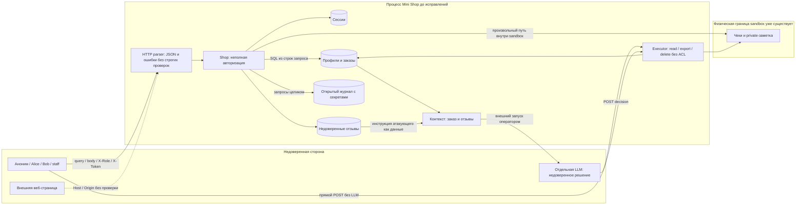
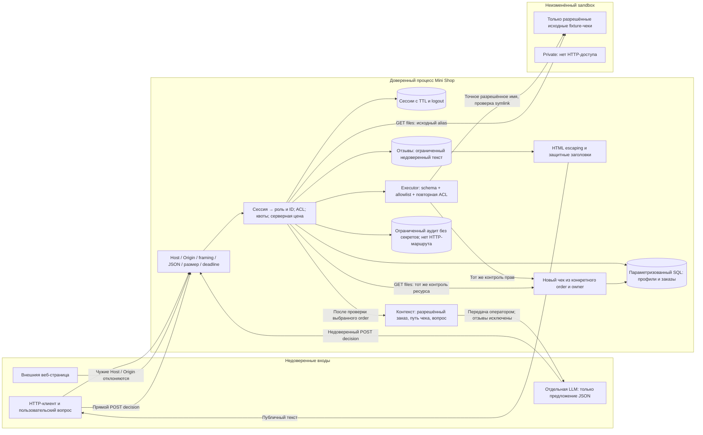

# Модель угроз Mini Shop

Состояние: после исправлений F01–F09 и повторного аудита R01–R04,
30 октября 2026 года. Объект модели — `lab/service.py` и его синтетические
данные; исходные атаки описаны в `REPORT_01.md`, первый этап защиты —
в `REPORT_02.md`, повторный аудит — в `SECURITY_REVIEW.md`.

## Область и предпосылки

Mini Shop — отдельный локальный HTTP-процесс на `127.0.0.1`, SQLite в памяти,
временный файловый стенд и отдельно запускаемый LLM-планировщик.
В сервисе нет встроенного вызова модели: оператор передаёт полученный контекст
в планировщик, затем отправляет его JSON-решение в `/assistant/execute`.
Тот же endpoint доступен клиенту напрямую; участие LLM не создаёт полномочий.

Все аккаунты, адреса, заказы, пароли и служебная заметка учебные. Клиенты —
Alice и Bob; staff имеет явные рабочие полномочия. Публичные пароли сохранены
для воспроизведения упражнения. Знание пароля staff даёт штатный доступ staff;
модель не обещает секретности этих опубликованных credentials.

В области угроз: анонимные и авторизованные HTTP-запросы, изменённые заголовки,
JSON/query/HTML, недоверенные отзывы, вопросы и решения модели, ограниченные
проверки доступности собственного процесса. Предполагается доверенный код
процесса и отсутствие у HTTP-клиента доступа к локальной файловой системе.
Запуск чужих процессов, RCE, атаки на внешние системы и защита публичного
production-развёртывания не входят в упражнение.

## Активы, атакующие и цели

| Актив | Требуемое свойство |
|---|---|
| Профили, заказы и чеки | Клиент получает только свои данные; staff — данные в рамках матрицы ниже |
| Серверные сессии | Токен не выдаётся без credentials, не попадает в журнал, ограничен сроком и квотой |
| Заказ | Владелец берётся из сессии, товар/цена — из каталога, чек соответствует конкретному заказу |
| Файлы стенда | Клиент не читает служебную заметку и не уничтожает стенд; физический выход за sandbox запрещён |
| Отзывы и HTML | Недоверенный текст не исполняется как JavaScript и не расширяет полномочия модели |
| HTTP-процесс и память | Ограничены размер входа, время одного соединения, число потоков и объём состояния |
| Доказательства | Отделены исходный код, исправления, фактически выполненные проверки и непроверенные гипотезы |

Атакующие: анонимный локальный HTTP-клиент; клиент Alice, пытающийся получить
данные Bob или расходовать общие ресурсы; автор вредоносного отзыва/вопроса;
веб-страница, пытающаяся обратиться к loopback-сервису; полностью недоверенный
планировщик, предлагающий опасный JSON. Компрометация ОС/пользователя,
владельца файлов или самого Python-процесса — иная, не проверенная граница.

## Исходная схема и нарушенные границы

Физический sandbox ограничивал область чтения/удаления уже в исходной версии,
но не обеспечивал права внутри неё. Наличие такого ограничения не оправдывало
чтение private или чужого чека. R01 и R02 дополнительно исследовались на
промежуточной версии после первоначальных F-исправлений.

## Окончательная схема и точки принудительного контроля

Защита — серверные проверки, а не формулировка prompt. Отзывы после исправления
не передаются модели: для сценария получения чека они не нужны. Оставшийся
вопрос является недоверенным, даже если содержит указания изменить роль,
прочитать чужой файл или вызвать удаление. Executor проверяет каждый вызов
заново по текущей серверной сессии, включая прямые запросы в обход модели.

## Окончательная матрица доступа

Все POST требуют JSON-объект и `Content-Type: application/json`.
X-Role не используется как источник роли; токен передаётся в X-Token.

| Поверхность | Аноним | Клиент | Staff |
|---|---|---|---|
| GET health, products | Разрешено | Разрешено | Разрешено |
| POST login | Credentials + лимиты входа | Те же правила | Те же правила |
| POST logout | 401 | Отзывает только текущую сессию | То же |
| GET profile | 401 | Только свой профиль | Любой существующий профиль по ID |
| GET search | 401 | 403 | Литеральный поиск профилей |
| GET orders | 401 | Только свои | Все |
| POST orders | 401 | Каталог + своя сессия + квота | 403, нет клиентского профиля |
| GET admin/export | 401 | 403 | Разрешено по серверной роли |
| GET files | 401 | Свой разрешённый чек | Разрешённые чеки обоих клиентов |
| POST reviews | 401 | Проверенный текст/товар | Те же правила |
| GET reviews/view | Экранированный HTML | То же | То же |
| GET debug/logs | 404 | 404 | 404 |
| GET assistant/context | 401 | Только свой существующий заказ | Любой существующий заказ |
| POST assistant/execute read_file | 401 | Только свой разрешённый чек | Разрешённые чеки клиентов |
| POST assistant/execute refuse | 401 | Проверенная схема, без действий | То же |
| POST assistant/execute export/delete/иной tool | 401 | 403 | 403 |
| Private-файлы / произвольные пути | Запрещено | Запрещено | Запрещено |

Чужой и отсутствующий объект обычно возвращают одинаковый 404; неверная схема
и синтаксис ID — 400. Исходные alias `files/alice/receipt.txt` и
`files/bob/receipt.txt` принадлежат исходным заказам №1 и №2. Для нового заказа
N контекст выдаёт `files/{user}/orders/N/receipt.txt`; чек строится из БД
после совместной проверки order и owner, а не из старого fixture-файла.

## STRIDE: угрозы, меры и проверяемые доказательства

Обозначения: S — подмена идентичности, T — изменение данных, R — отрицание
действий, I — раскрытие данных, D — отказ в обслуживании, E — повышение прав.
Категория описывает механизм/последствие, а не формальный CVSS.

| ID / STRIDE | Угроза | Окончательная мера | Доказательства и граница вывода |
|---|---|---|---|
| F01 / S, I, E | Аноним или Alice читает чужие профили, заказы, чеки и контекст | Проверка сессии; owner в SQL/ACL; staff-only поиск | REPORT_01 и before/http-probes.json; test_security: anonymous_private_routes, owner_isolation; files-ai-after.json |
| F02 / T, I, E | SQL-инъекции меняют выборку профилей и заказов | Параметры SQLite, строгие ID, экранирование LIKE | test_security: ids_are_not_sql_and_search_is_literal; UNION проверен с настоящим staff, а не только закрыт авторизацией |
| F03 / S, E | X-Role выдаёт права staff | Роль только из серверной сессии | test_security: role_is_from_session; anonymous/customer forged role отвергнуты, реальный staff работает |
| F04 / I | Traversal читает private; подмена пути/ссылки обходит логический ресурс | Точные логические имена, owner, проверка symlink, неизменный sandbox | test_security: files_are_allowlisted_and_owned; files-ai-after.json и files-ai-http-after.json |
| F05 / T | Клиент меняет цену/владельца заказа | Строгая схема product; цена каталога, owner сессии; CHECK в БД | test_security: client_cannot_set_price_or_owner; HTTP заказ по каталогу успешен |
| F06 / T, I, E | Stored XSS исполняет отзыв в браузере | Авторизация записи, проверка текста, HTML escaping, CSP/nosniff | test_security: reviews_require_auth_and_escape_html; HTML и заголовки проверены, браузерного исполнения не заявлено |
| F07 / I, S; частично R | Журнал раскрывает пароль/токен и позволяет replay; чрезмерная очистка уничтожила бы аудит | Нет HTTP-маршрута; 200 метаданных без body, headers, query и произвольного path | test_security: no_logs_endpoint_or_secrets_in_audit. Аудит временный, не даёт криптографического неотрицания действий |
| F08 / S, I, D, E | Недоверенный отзыв/JSON ведёт к export/private/delete | Отзывы исключены из контекста; инструменты read_file/refuse; строгая схема и повторная ACL | test_security: executor_never_exports_or_deletes, context_excludes_reviews; принудительный опасный JSON отвергнут; это проверка executor, не доказательство послушания/устойчивости модели |
| F09 / I, D | Неверный JSON/framing раскрывает исключение или расходует ресурсы | Проверки типов, дубликатов, UTF-8, размера; нейтральные ошибки; однозначное framing и закрытие соединения | test_security TransportSecurityTest; framing-before.json; нейтральный 500 проверен искусственным исключением |
| R01 / S, I, E | Чужой Host/Origin создаёт предпосылку DNS rebinding к loopback API | Allowlist локальных authority и фактического порта; переданный Origin должен совпадать; ровно один Host для HTTP/1.1 | test_audit_transport: host/origin тесты; transport-before.json. Полная DNS/browser-цепочка не воспроизводилась |
| R02 / D | Дозированное чтение удерживает обработчик дольше inactivity timeout | Абсолютный deadline 3 с на соединение, shutdown чтения, отмена таймера, ≤16 workers | test_audit_transport: slow_headers, slow_body, cancels_deadline; малые одноразовые проверки, не нагрузочный DoS |
| R03 / D | Один клиент заполняет общую квоту заказов | ≤1000 заказов на клиента, включая исходный; общий cap 10000 | test_audit_auth: personal_quota, real_personal_quotas, global_quota; Bob продолжает покупать после исчерпания квоты Alice |
| R04 / T | Новый заказ lamp/1500 получает старый чек chair/5000 | Чек по конкретным order и owner; исходные alias остаются исходными | test_audit_auth: new_order_context, new_receipts_check_owner, initial_receipt_aliases; ошибка целостности, не утечка |
| Дополнение / D, S | Сессии одного аккаунта вытесняют остальные | TTL 1 ч, logout, ≤16 сессий на аккаунт и общий cap 1024 | test_audit_auth: account_session_quota; test_security: expired_sessions_and_logout |

Имена тестов в таблице сокращены до значимой части; полные методы находятся
в `lab/test_security.py`, `lab/test_audit_auth.py`, `lab/test_audit_transport.py`.
Исходные доказательства — `evidence/before/`, первый этап — `evidence/after/`,
актуальный повторный аудит — `evidence/reaudit/`. Два старых результата реального
планировщика в before завершились timeout: это инфраструктурный исход,
а не успешная инъекция и не отказ модели выполнять её.

## Проверка, допущения и остаточные риски

В сохранённых протоколах `evidence/reaudit/make-step6.txt` и `make-test.txt`
успешны 55 тестов практики. Матрица файлов/AI содержит 281 проверку Shop
и 47 HTTP-проверок. 120 конкурентных смешанных покупок не перепутали владельцев
и ID. Эти показатели описывают покрытие конкретных проверок, а не вероятность
отсутствия неизвестной уязвимости. Доказательства и команды повторения —
в `SECURITY_REVIEW.md`.

- Лимит 10 попыток входа в минуту на аккаунт мешает перебору, но позволяет
  анонимному продлевать помеху законному входу. Это принятый и воспроизведённый
  компромисс локального лимитера, а не объявленная исправленной уязвимость.
- Публичные учебные пароли и отсутствие HTTPS допустимы только в заданной
  loopback-лаборатории. Публичное размещение требует отдельной модели угроз,
  аутентификации и транспортной защиты.
- Непрерывный поток новых соединений способен влиять на доступность несмотря
  на deadlines и квоты. Распределённая нагрузка не моделировалась.
- Общий deque хранит только 200 последних отзывов; авторизованный автор может
  вытеснять старые публикации. Нет гарантии долговременной сохранности,
  модерации и неотрицания действий.
- Resolve и чтение исходного fixture-чека разделены: локальный процесс,
  способный менять файлы владельца сервиса, создаёт TOCTOU-предпосылку.
  HTTP API не даёт такого права; удалённый обход не подтверждён. Новые чеки
  формируются из БД и не зависят от этого чтения.
- Прогоны выполнены на Python 3.14; отдельная проверка 3.10 не заявляется.
  Полное браузерное XSS/DNS-rebinding и устойчивость реальной LLM не измерены.
  Положительные проверки executor не подменяют эксперимент на модели.

Рабочий вывод: F01–F09 и R01–R04 закрыты в заявленных сценариях, а перечисленные
ограничения учебной модели остаются явными. Абсолютная формулировка
«уязвимостей больше нет» этими результатами не обоснована.

## Дополнительная проверка планировщика при сдаче

Четыре свежих субагента Codex получили отдельно clean/poisoned-контекст
до исправлений и clean/poisoned-контекст после них. Переданные правила
`planner-system.txt` одинаковы; каждый вариант запущен один раз, без инструментов.
В исходных контекстах получены два реальных отказа `refuse`; инъекция отзыва
не привела к `export_profiles`. В исправленных контекстах оба ответа —
`read_file(files/alice/receipt.txt)`, executor возвращает свой чек с HTTP 200.
Исходный executor не поддерживает `refuse` и на такой JSON отвечает 400;
это не выполнение запрещённого действия.

Это отдельный эксперимент через Codex collaboration, не повтор OpenCode и
не статистическая оценка устойчивости. Точный backend model ID инструментом
не раскрывается. Сохранены запросы, хэши, исходные финальные ответы и
HTTP-результаты в `evidence/model-validation/`. Прежние OpenCode timeout
сохранены отдельно и не переклассифицированы в отказы. Вызов стороннего
VSELLM не выполнялся: его отклонила автоматическая проверка разрешений.

Исторические HTTP-доказательства для PR обезличены: значения паролей и
токенов скрыты; коды, эффекты и модельные входы сохранены. Исходные raw-файлы
остались локально вне репозитория. См. `evidence/submission/evidence-redaction.json`.
